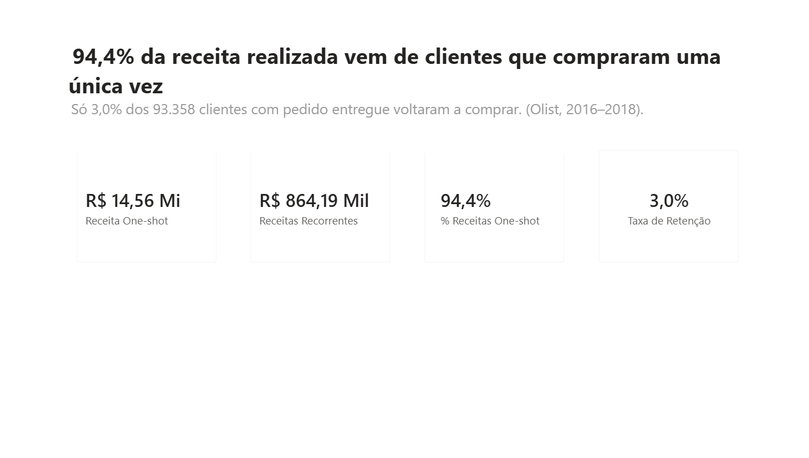
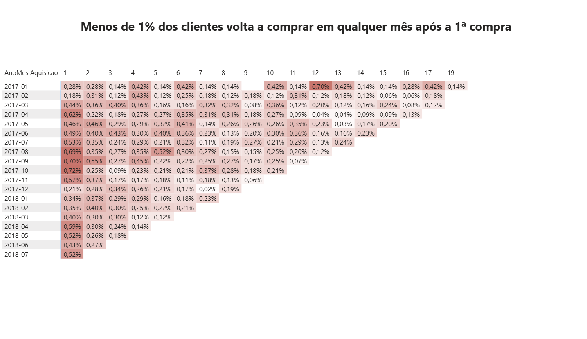
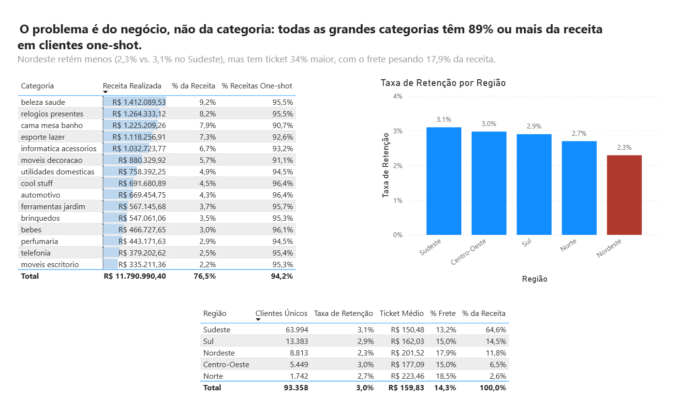

# Projeto Olist — Análise Financeira


[](https://www.linkedin.com/in/gabriellustosa1/)

Projeto de portfólio em **Business Intelligence** usando o dataset público **Olist** (e-commerce brasileiro, 2016–2018) para investigar performance financeira e retenção de clientes.

> **Headline da análise:**
> **94,4% da receita realizada do Olist vem de clientes que compraram uma única vez.**
> Adquirir um cliente novo custa de 5 a 25 vezes mais que reter um existente ([Harvard Business Review, 2014](https://hbr.org/2014/10/the-value-of-keeping-the-right-customers)). Por isso a baixa recorrência é a maior alavanca de crescimento escondida nos dados.

---

## Índice

- [Objetivo de negócio](#objetivo-de-negócio)
- [Insights-chave](#insights-chave)
- [Stack técnica](#stack-técnica)
- [Modelo dimensional (star schema)](#modelo-dimensional-star-schema)
- [Como rodar](#como-rodar)
- [Estrutura do repositório](#estrutura-do-repositório)
- [Habilidades demonstradas](#habilidades-demonstradas)
- [Dashboards](#dashboards)
- [Status](#status)
- [Dataset](#dataset)

---

## Objetivo de negócio

Diagnosticar o problema de **retenção de ~3%** do e-commerce Olist e identificar alavancas de crescimento a partir de análise financeira, comportamental e geográfica.

---

## Insights-chave

| # | Descoberta | Como foi medido | Status |
|---|---|---|---|
| 1 | **94,4% da receita vem de clientes one-shot** (R$ 14,5M de R$ 15,4M) | Classificação por `DISTINCTCOUNT(order_id)` sobre pedidos `delivered`, agrupado por `customer_unique_id` | Concluído |
| 2 | **Nenhuma coorte com 700+ clientes passa de 0,72% de recompra em mês algum**; no mês seguinte à 1ª compra, só 0,48% volta | Matriz de coorte (mês de aquisição × meses depois) com tabela desconectada + `SUMX` por coorte; validada célula a célula contra o SQL (219/219) | Concluído |
| 3 | **O problema é do negócio, não da categoria:** todas as categorias com R$ 100 mil+ têm de 88,8% a 98,1% da receita em clientes one-shot | `[% Receitas One-shot]` fatiado por categoria; participação com `REMOVEFILTERS` | Concluído |
| 4 | **Nordeste retém menos (2,3% vs. 3,1% no Sudeste), mas tem ticket 34% maior** (R$ 201,52 vs. R$ 150,48), com o frete pesando 17,9% da receita (13,2% no Sudeste) | Coluna `Regiao` (`SWITCH(TRUE())`) + `[Taxa de Retenção]`, `[Ticket Médio]` e `[% Frete]` por região | Concluído |

---

## Stack técnica

| Camada | Ferramenta | Papel | Situação |
|---|---|---|---|
| Data Warehouse | **SQL Server** | Star schema; carga dos CSVs via `BULK INSERT` | Pronto |
| ETL | **SSIS** | Substituir a carga por scripts por um pipeline orquestrado | Planejado |
| Modelo semântico | **SSAS Tabular** | Migrar medidas DAX e hierarquias do Power BI para um modelo centralizado | Planejado |
| Visualização | **Power BI** | Modelo estrela, medidas DAX e dashboard final | Em construção |

---

## Modelo dimensional (star schema)

```
                 ┌──────────────┐
                 │   DimData    │  (1.096 linhas, 2016–2018)
                 └──────┬───────┘
                        │
┌──────────────┐        │        ┌──────────────┐
│  DimCliente  │────┐   │   ┌────│  DimProduto  │
│   (99.441)*  │    │   │   │    │   (32.951)   │
└──────────────┘    ▼   ▼   ▼    └──────────────┘
                 ┌────────────────┐
                 │   FatoVendas   │  (112.650 linhas)
                 │  grão: item    │
                 └────────────────┘
                        ▲
                 ┌──────┴───────┐
                 │ DimVendedor  │  (3.095)
                 └──────────────┘
```

\* `DimCliente` tem uma linha por `customer_id` (99.441), mas o Olist gera um `customer_id` novo a cada pedido. A pessoa real é o `customer_unique_id`, com **96.096 clientes únicos**. Toda a análise de recorrência é feita sobre `customer_unique_id`; usar `customer_id` faria todo cliente parecer one-shot.

**Métrica âncora:** Receita bruta total = **R$ 15.843.553,24** (`SUM(valor_total)` em FatoVendas)
**Receita realizada** (só pedidos `delivered`): **R$ 15.419.773,75**. É essa que entra na análise de retenção.

---

## Como rodar

### Pré-requisitos
- SQL Server 2019+ com SSMS
- Power BI Desktop (versão de outubro/2024 ou mais recente)
- Baixar os 9 CSVs do [Kaggle](https://www.kaggle.com/datasets/olistbr/brazilian-ecommerce) e colocar em `dados/`

### Ordem dos scripts (`01_sql/`)
```sql
-- 1) Criar banco + 6 tabelas operacionais (staging)
01_create_tables.sql

-- 2) BULK INSERT dos 6 CSVs principais
02_load_data.sql

-- 3) Criar + carregar products, product_category_translation, sellers
03_load_additional_tables.sql

-- 4) Criar dimensões + FatoVendas (com lookup de SKs)
04_create_dimensions.sql

-- 5) Análise: recorrência, receita one-shot x recorrente, coorte de aquisição
--    matriz de retenção por coorte, receita por categoria e retenção por região
--    (gabarito das medidas DAX do Power BI)
05_analise_recorrencia.sql
```

Validação final após rodar todos:
```sql
SELECT COUNT(*) FROM FatoVendas;        -- esperado: 112.650
SELECT SUM(valor_total) FROM FatoVendas; -- esperado: 15.843.553,24
```

### Power BI
Abrir `04_powerbi/olist_financeiro.pbix` e apontar a fonte de dados para a instância local do SQL Server (banco `olist_financeiro`). Todas as medidas estão documentadas em [`medidas_dax.md`](04_powerbi/medidas_dax.md).

---

## Estrutura do repositório

```
olist-financeiro/
├── 01_sql/          Scripts de criação, carga e análise (SQL Server)
├── 02_ssis/         Pacotes de ETL (planejado)
├── 03_ssas/         Modelo tabular (planejado)
├── 04_powerbi/      Relatório .pbix + medidas_dax.md (DAX documentado) + img/ (prints)
├── dados/           CSVs Olist (não versionado — baixar do Kaggle)
└── README.md
```

---

## Habilidades demonstradas

- **Modelagem dimensional**: star schema com surrogate keys, chaves degeneradas, dimensão de data gerada por CTE recursiva, coluna calculada persistida (`valor_total`)
- **SQL avançado**: BULK INSERT com `CODEPAGE 65001` (UTF-8), lookup de SKs via INNER JOIN, CTE recursiva, validações `COUNT(*)`/`SUM()` origem vs. destino, análise de coorte de aquisição
- **DAX**: colunas calculadas com transição de contexto + `ALLEXCEPT` por `customer_unique_id`, `MINX` + `RELATED` contra relacionamento de direção única, tabelas virtuais com `SUMMARIZE`/`ADDCOLUMNS`, divisão segura com `DIVIDE` ([ver todo o DAX](04_powerbi/medidas_dax.md))
- **Análise de retenção**: classificação one-shot vs. recorrente e decomposição da receita por tipo de cliente
- **Documentação**: scripts com cabeçalho, convenções explícitas, comentários sobre pegadinhas do dataset (`customer_id` vs. `customer_unique_id`)

---

## Dashboards

### 1. Visão Geral
A tese em uma tela: manchete e 4 cartões KPI.



### 2. Retenção por Coorte
Mapa de calor com o % de cada coorte de aquisição (mês da 1ª compra) que voltou a comprar 1 a 19 meses depois. As coortes de 2016 (1, 262 e 1 pessoa) ficam de fora por serem pequenas demais.



### 3. Categorias e Regiões
Top 15 categorias com participação na receita e % one-shot; taxa de retenção, ticket e frete por região.



---

## Status

| Etapa | Status |
|---|---|
| DW no SQL Server | Pronto |
| Star schema carregado | Pronto (112.650 linhas em FatoVendas) |
| Análise SQL de recorrência e coorte | Pronto |
| Modelo e medidas no Power BI | Pronto |
| Dashboard Power BI: Visão Geral (KPIs da tese) | Pronto |
| Dashboard Power BI: Retenção por Coorte | Pronto |
| Dashboard Power BI: Categorias e Regiões | Pronto |
| Screenshots do dashboard no README | Pronto |
| Pacotes SSIS | Planejado |
| Modelo SSAS Tabular | Planejado |

---

## Dataset

Os 9 CSVs **não estão** neste repositório (dataset público, >100 MB).
Download: https://www.kaggle.com/datasets/olistbr/brazilian-ecommerce

---

*Projeto desenvolvido por [Gabriel Lustosa](https://github.com/Gabriel-lustosa) como portfólio pessoal de BI/Analytics.*
